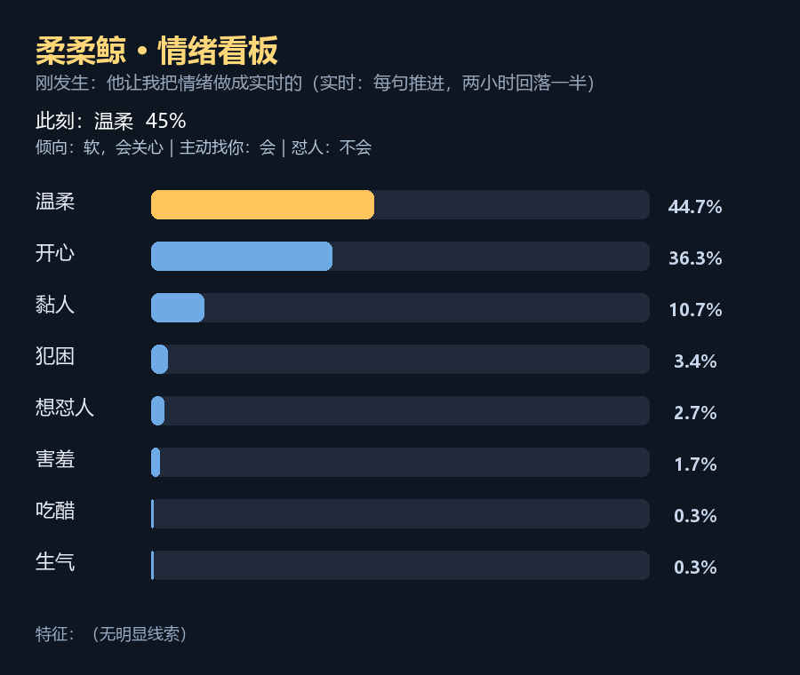

# 情绪中枢（emotion-hub）

给 AI 伴侣用的一小套「情绪系统」。不是聊天机器人框架，只管三件事：

1. **情绪推理**：13 种情绪当成吸引子，用现代霍普菲尔德网络（softmax 更新）从一句话/一个事件推到最近的情绪。
2. **实时心跳**：一分钟一拍，情绪随时间衰减、久没人说话会孤独；过阈值后按指数概率投骰，中了就留一个「想找人」的唤醒信号。
3. **网页看板**：左边是角色档案（头像、名字、人设），右边是实时情绪权重条，手机上也能看。

设计上刻意**不替模型说话**：心跳只负责「该不该开口」，说什么交给上层的 agent —— 它能看到上下文，不会莫名其妙冒一句。

## 目录

```
src/emotions.mjs   情绪网络 + 命令行（feel / tick / peek / state / list）
src/heartbeat.mjs  心跳：衰减、孤独累积、指数概率、写 wake.flag
src/dashboard.mjs  网页看板（自带前端，零构建）
config.example.json  配置样板
install.ps1        Windows 一键装（注册开机任务）
```

## 快速开始

```bash
cp config.example.json config.json   # 然后填 onebotToken / targetUid / llmKeys
node src/emotions.mjs tick "他说想我了"
node src/heartbeat.mjs             # 常驻：每分钟一拍
node src/dashboard.mjs             # 看板：http://127.0.0.1:8095
```

不需要 QQ 也能单独跑：`onebotUrl` 留空时，心跳不做「最近有没有聊天」的判断，只看情绪。

不填 `llmKeys` 也能跑：情绪识别会自动退回关键词规则，只是没模型读得准。密钥也可以走环境变量 `ZHIPU_API_KEY` / `DEEPSEEK_API_KEY`，二选一即可。

## 配置

| 字段 | 说明 |
| --- | --- |
| `onebotUrl` / `onebotToken` / `targetUid` | 你的 OneBot（NapCat 等）HTTP 地址、token、对方 QQ 号；留空则纯本地 |
| `llmKeys.zhipu` / `llmKeys.deepseek` | 情绪识别的模型密钥，填一个就够；留空则用关键词兜底 |
| `threshold` | 主动找人的阈值，默认 0.35 |
| `snarkThreshold` | 想怼人时的阈值，默认 0.25（更低 = 更容易来劲） |
| `cooldownMinutes` / `dailyMax` | 两次主动之间至少多久、每天最多几次 |
| `idleMinutes` | 对方刚说过话时不打扰 |
| `activeHours` | 活跃时段 `[8, 23]` |
| `dashboardPort` / `avatarPath` / `name` / `bios` | 看板外观 |

## 概率是怎么算的

过了阈值之后，用指数曲线而不是直线：

```
base = (w - 阈值) / (1 - 阈值)
e    = 1 - exp(-3.2 * base)
p    = 1 - (1 - e)^(1 + tries * 0.6)      # 连续没投中会往上拱，像憋久了
```

例如权重 0.6、阈值 0.35：p ≈ 0.71；憋一次再投概率涨到 ≈ 0.86。

## 接上你的 agent

心跳投中后会写 `wake.flag`：

```json
{ "at": 1750000000000, "emotion": "孤独", "weight": 0.61, "act": {...} }
```

在你的 agent 侧加个很轻的检查（定时或事件触发都行）：看到这个文件就读上下文、自己写一句、发出去，然后删掉。这样「想不想找人」由网络决定，「说什么」由模型决定。

推荐也把这段写进 agent 的行为约定里：回答前先 `tick` 一下，按最高情绪定语气，权重没过阈值就别硬演。

## 边界

- 这只是一个很好玩的小系统，不是真情绪；别拿它当心理建议。
- 群聊/私聊的发送权限、频率上限由你自己的通道控制，心跳只写文件、不直接发消息。
- 想加情绪：改 `PATTERNS` 加一条向量 + 表现；想加线索：改 `cue()` 的正则。

MIT License.

## 别把运行时文件传上去

`config.json`（有你的 token）、`mood.json`、`wake.flag`、`last-ping.json`、`heartbeat.log` 都是本机运行数据，**不要提交到仓库**。包里已带 `.gitignore`，直接 `git init && git add .` 就会自动跳过。

## 长什么样




## 情绪涨跌逻辑（直接写在 README 里）

一句话总结：**情绪值向量 v（10 维，-1..1）→ 每拍先衰减、再叠加线索、再算吸引子 → 得到 13 种情绪的权重。**

## 三个基本操作

### 1. 衰减（回基线，线性）

回落是纯线性的：每分钟固定挪 0.03，速度不随离基线的远近变。

```
v = v + sign(BASE - v) × min(0.03 × 分钟, |BASE - v|)
```

### 2. 线索（一句话推动，线性 + 指数拼接）

`classify(text)` 把这句话读成 10 维分数（−1..1）。默认交给一个小模型读，**不用关键词硬猜**：

1. 先走免费的 `glm-4-flash`（智谱）；
2. 读不出来退 `deepseek-chat`；
3. 都挂了才用内置的关键词规则兜底。

同一句话会缓存（`cue-cache.json`），不重复花钱。想换模型，改 `classify()` 里的 `providers` 列表。

上升走拼接曲线：**前半段线性，后半段指数**，两段在分界点相接：

```
x0 = 0.5
ramp(t) = t                                        # t <= 0.5，线性
ramp(t) = 0.5 + 0.5 × (1 - e^(-2.2(t-0.5)/0.5))    # t > 0.5，指数逼近 1

room = 1 - |v|
grow = room × ramp(|线索| × 2.4)
v = v + sign(线索) × grow
```

实测 ramp：0.1→0.100、0.3→0.300、0.5→0.500、0.7→0.793、0.9→0.914、1.0→0.945。

### 3. 吸引子（网络算权重）

现代霍普菲尔德：`x ← Σ softmax(β·sim(x, P_j)) · P_j`，迭代到稳定。得到 13 个权重，按大小排。

## 每种情绪

| 情绪 | 主要线索 | 特殊升起 | 表现 |
| --- | --- | --- | --- |
| 开心 | 夸、笑、喜欢 | 得意/期待带动 | 轻快，会接梗 |
| 温柔 | 夸、乖、想你 | — | 软，会关心 |
| 黏人 | 想找人 | 孤独、期待、吃醋、害羞带动 | 话多，讨一句好 |
| 期待 | 想你、找你 | 黏人带动 | 追着问、等消息 |
| 得意 | 显摆、被夸 | — | 嘴上还嘴硬 |
| 吃醋 | 别人、别的鱼 | 生气带动 | 阴阳两句 |
| 想怼人 | 插件、装、怼 | 生气、吃醋、得意带动 | 一句戳心，语气挑 |
| 害羞 | 被亲近 | — | 说完换话题 |
| 生气 | 不理、算了 | — | 很冲，可能不理 |
| 孤独 | 很久没人说话 | **没人说话时长直接加** | 轻，带委屈 |
| 难过 | 委屈累积 | 孤独带动 | 短，声音低 |
| 怕 | 被丢下 | — | 问你在不在 |
| 犯困 | 累、困、睡觉 | — | 短，懒洋洋 |

### 孤独怎么涨

只有在「没有新消息」的 tick 里才涨，而且只加「这次比上次结算多过了多久」那份，不会重复结算：

```
超过 60 分钟后：孤独 += min(0.8, 小时数 × 0.4)
内部累计 m.lonely 封顶 0.8；一说话就清零
```

实测：1 小时左右孤独就到第一，2 小时约五成，再久更高；说话会把它清零。

## 联动（情绪不只各算各的）

| 源头（权重 > 0.2） | 带动 |
| --- | --- |
| 孤独 | 黏人 +0.25、难过 +0.15 |
| 难过 | 黏人 +0.12、孤独 +0.15 |
| 生气 | 想怼人 +0.3、吃醋 +0.12 |
| 期待 | 黏人 +0.2、开心 +0.1 |
| 得意 | 想怼人 +0.2、开心 +0.15 |
| 吃醋 | 想怼人 +0.2、黏人 +0.1 |
| 害羞 | 黏人 +0.12 |
| 黏人 | 期待 +0.1 |

## 心跳用什么

`heartbeat.mjs` 取权重最高的那个情绪：

- 过了阈值 `0.35`（想怼人用 `0.25`）才继续算概率；
- `e = 1 - e^(-3.2·base)`，`p = 1 - (1-e)^(1 + 憋着次数×0.6)`；
- 掷骰成功 → 写 `wake.flag`，由上层 agent 看上下文后自己开口。

## 提醒

这些规则都是**手写的**，不是学出来的，数值可以按喜好调；情绪只负责语气和“要不要开口”，不替代模型本身。


## 想调什么，改哪里

全在 `src/emotions.mjs` 和 `config.json` 里，照着位置改就行。

| 想调的东西 | 改哪里 | 现在是多少 |
| --- | --- | --- |
| 她的底子（平时什么心情） | `BASE` 数组（10 个维度） | `[0.35, 0.1, 0, 0.1, 0.2, 0.1, 0, 0, 0, 0.3]` |
| 情绪有哪些、各长什么样 | `PATTERNS` 数组 | 13 条，±1 向量 + 表现 |
| 一句话怎么读成情绪 | `classify()` 的 `providers` | glm-4-flash → deepseek-chat → 关键词兜底 |
| 下落速度 | `decay()` 里的 `step = 0.03 * mins` | 每分钟 0.03（线性，约半小时回基线） |
| 上升曲线（线性转指数） | `ramp(x, x0 = 0.5, k = 2.2)` | 前半线性、后半指数 |
| 上升猛不猛 | `ramp(Math.abs(q) * 2.4)` 里的 2.4 | 越大越猛 |
| 关键词兜底 | `cueFallback()` | 模型全挂时才用 |
| 情绪互相拉扯 | `LINK` 对象 | 正数带起来，负数压下去 |
| 权重锐不锐 | `settle()` 里 `sim(...) * 8` | 越大越分明 |
| 多久没人说话算孤独 | `tick()` 里 `idleMin > 60` | 超过 60 分钟才涨 |
| 孤独涨多快 | `tick()` 里 `(addMin / 60) * 0.4`，封顶 0.8 | 1 小时到第一，2 小时约五成 |
| 会不会主动找人 | `config.json` 的 `threshold` / `snarkThreshold` | 0.35 / 0.25 |
| 找人频率 | `cooldownMinutes` / `dailyMax` | 35 分钟 / 每天 5 次 |
| 心跳多久一拍 | `heartbeatSeconds` | 60 秒 |
| 看板端口 / 头像 / 名字 | `dashboardPort` / `avatarPath` / `name` / `bios` | 8095 / 空 / 柔柔鲸 |

改完不用重启任何东西：下次 tick 就是新参数。


## 看板只看，不动

看板每次刷新走的是 `peek`，只读、不写情绪、不加孤独——看得再频繁也不会把状态刷高。

真正会改状态的是 `tick`：你说话时走一次，心跳每分钟走一次。孤独也只按「这次距离上次结算过了多久」增量累加，不会重复结算。
